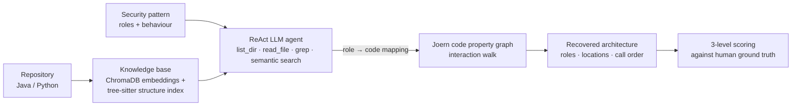

# 🔐 SecPatRec — Automated Security Pattern Recovery

**MSc Computer Science dissertation · University College Dublin** · by [Tran Tuan Dat](https://github.com/trandat9h)

> *Does this codebase actually implement password-based authentication the way the security catalogue prescribes? Where is each piece, and do the pieces call each other in the right order?*

Laws such as the **EU Cyber Resilience Act** ask manufacturers to build security in by design, and security pattern catalogues say what that design should look like. Checking a real codebase against those patterns is still manual work: a pattern is abstract, spans many components, and can be implemented in many valid ways.

**SecPatRec** automates that check. Give it a Java or Python repository and a security pattern; it reports

- **which roles of the pattern are present** — or missing, or delegated to an external library;
- **where each role lives** — the file, code entity and line that implements it;
- **how the roles interact** — the call sequence between them, derived from the code itself rather than guessed by the model.

## How it works

1. **Knowledge base** — the codebase is chunked and embedded into a ChromaDB index, alongside a tree-sitter index of its structure.
2. **Recovery agent** — a ReAct-style LLM agent with four tools (`list_dir`, `read_file`, `grep`, semantic `search`) maps each role of the pattern to code, or marks it missing or external.
3. **Interaction recovery** — the role mapping is walked on the repository's code property graph with [Joern](https://joern.io), yielding the order in which the roles actually call each other.

## What I built

| | |
| - | - |
| 🤖 **Hybrid recovery pipeline** | An LLM agent with semantic and keyword code search grounds each pattern role in code; a static CPG walk then recovers the interaction sequence, so the order is evidence from the code, not an LLM claim. |
| 🗂️ **Human-validated dataset** | 100 pattern instances — 5 security patterns across **93 open-source repositories** (44 Java, 49 Python), **5.3M lines of code**, the largest repository 743 KLOC. Ground truth built with a custom annotation portal. |
| 📏 **Three-level evaluation framework** | Level 1 role detection, Level 2 role grounding (containment distance in the code structure), Level 3 interaction recovery (Jaccard overlap × Kendall τ). Shipped as its own package so every consumer scores identically. |
| 🧪 **Multi-LLM study** | Four LLMs: GPT‑6.1 Sol and Muse Spark through their APIs; DeepSeek‑v4.0‑Flash and GLM‑5.3 self-hosted on B200/B300 GPUs on Modal. Plus a one-shot whole-repository baseline and code-search tool ablations. |

## Results

- **Accurate across models** — role detection 0.79–0.86, role grounding 0.83–0.86, interaction recovery 0.61–0.72, depending on the LLM.
- **Beats the one-shot LLM baseline on every metric for every model** — grounding +0.13 to +0.21, interaction recovery +0.10 to +0.21 — and still runs on the 16 repositories too large for the baseline's input limit.
- **Scales where the baseline cannot** — pipeline token cost barely grows with codebase size (log-log slope 0.08–0.28 vs 0.83–1.00 for the baseline), making it **6–60× cheaper** on 1M-token codebases; a run costs about **$0.005** (GLM) to **$0.05** (GPT‑6.1).
- **Static analysis pays off** — when the agent maps every role exactly (80 instances), the CPG walk recovers the full interaction sequence perfectly on 73 of them.
- **Search tools are interchangeable** — removing keyword or semantic search changes detection and grounding by less than 0.03; the agent shifts its calls to the remaining tool, so keyword search alone suffices when memory is tight.

📄 Paper: *A Hybrid Approach for Automated Security Pattern Recovery* — submitted to **MSR 2027** (Technical Track).

## Repositories

| Repository | What it is | Stack |
| ---------- | ---------- | ----- |
| [**secpatrec**](https://github.com/anonymousspottedtoad/secpatrec) | The recovery pipeline, its experiment runner and the `secpat` CLI — start here | Python · LLM agents · ChromaDB · tree-sitter |
| [**secpat_interaction_recovery**](https://github.com/anonymousspottedtoad/secpat_interaction_recovery) | Interaction-order derivation: walks the code property graph on a Joern query service or a local Joern install | Scala (Joern) · Python |
| [**secpat_evaluation_metrics**](https://github.com/anonymousspottedtoad/secpat_evaluation_metrics) | The Level 1–3 scoring package | Python |
| [**secpat_annotation_portal**](https://github.com/anonymousspottedtoad/secpat_annotation_portal) | Web tool annotators used to build the ground truth: map roles to AST symbols, browse code, review recoveries | React · Vite · TypeScript · FastAPI · MongoDB · Redis · Docker |

## Tech highlights

`Python` · `Scala` · `TypeScript` · LLM agents (ReAct, tool use) · RAG with ChromaDB · tree-sitter · Joern code property graphs · static analysis · FastAPI · React · MongoDB · Redis · Docker · GPU model hosting on Modal

## Contact

- ✉️ [trantuandat26@gmail.com](mailto:trantuandat26@gmail.com)
- 💼 [linkedin.com/in/dat-tt](https://www.linkedin.com/in/dat-tt)
- 💻 [github.com/trandat9h](https://github.com/trandat9h)
